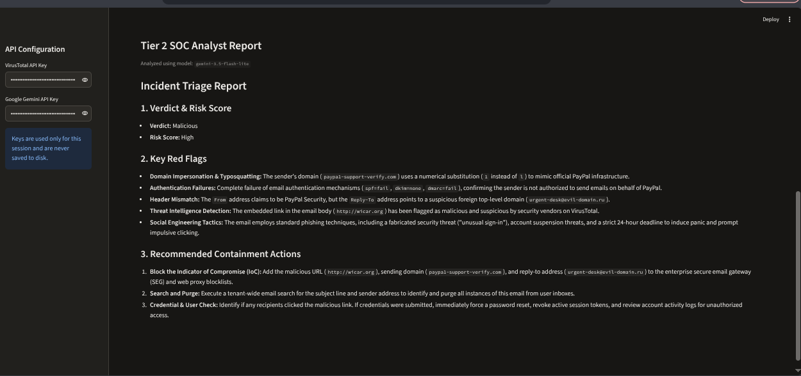

# 🛡️ Automated Phishing Triage & Threat Intel Agent

An AI-powered Security Operations Center (SOC) assistant built with Python, Streamlit, VirusTotal API, and Google Gemini. It automates Tier 1/Tier 2 phishing email triage by parsing raw email headers, enriching extracted URLs with live threat intelligence, and generating structured incident response reports.



## 🚀 Key Features
* **Automated Header & IOC Extraction:** Parses `.eml` files or raw email text to inspect `From`, `Reply-To`, `Return-Path`, and `Authentication-Results` (SPF/DKIM/DMARC) while extracting embedded URLs via Regex.
* **Live Threat Intelligence Enrichment:** Queries the VirusTotal v3 API using Base64-encoded URL identifiers to retrieve multi-vendor malicious/suspicious detection scores.
* **AI Tier 2 SOC Triage:** Prompts Google Gemini with structured evidence to produce an executive risk score, technical & social engineering red flags, and immediate containment actions.
* **High-Availability Model Failover:** Implements automatic retry and fallback routing across Gemini models (`gemini-3.8-flash` → `gemini-3.5-flash-lite`) to handle API rate limits and demand spikes gracefully.

## 🛠️ Tech Stack
* **Language:** Python 3
* **Frontend:** Streamlit
* **Threat Intelligence:** VirusTotal v3 REST API
* **AI / LLM:** Google GenAI SDK (`gemini-3.8-flash` / `gemini-3.5-flash-lite`)

## ⚙️ Installation & Usage

1. **Clone the repository:**
   ```bash
   git clone https://github.com
   cd ai-phishing-analyst
   ```

2. **Install dependencies:**
   ```bash
   pip install -r requirements.txt
   ```

3. **Run the application:**
   ```bash
   streamlit run app.py
   ```

4. **Analyze an email:**
   * Enter your free **VirusTotal API Key** and **Google Gemini API Key** in the sidebar.
   * Upload one of the test `.eml` files from the `sample_emails/` folder or paste raw email headers and body text.
   * Click **Analyze Email** to generate the triage report.

## ⚠️ Disclaimer
This tool is built for educational and defensive SOC triage demonstration purposes. Always verify automated AI findings before executing production containment actions.

